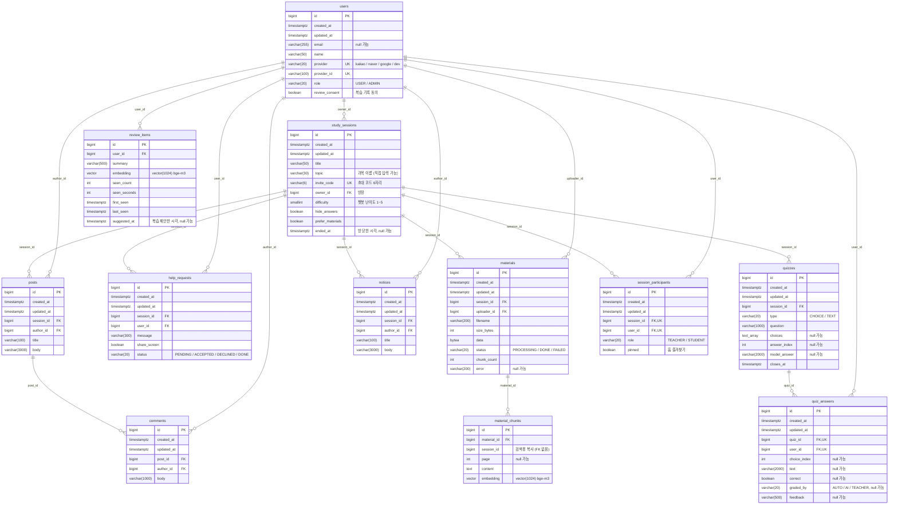

# ERD

- 논리 ERD: `ERD-logical.png` / `.pdf` — 한국어 엔터티 · 속성, 식별자와 관계(1:N, 사용자–방 N:M 은 ‘방 참가’로 풂)만
- 물리 ERD: `ERD-physical.png` / `.pdf`, 아래 Mermaid — 실제 테이블 · 컬럼 · 타입 · 키

실제 DB(Flyway V1~V10 적용 후)에서 뽑았다. Flyway · Spring Session 테이블은 뺐다. 다시 뽑을 때는 이 그림들을 새로 만든다 (DB 를 바꾸면 같이 갱신).
같은 사람이 같은 방에 두 번 들어갈 수 없다 (`session_participants` 의 session_id+user_id 유니크), 질문 하나에 답은 한 사람당 하나 (`quiz_answers` 의 quiz_id+user_id 유니크).

| 테이블 | 뜻 |
|---|---|
| `comments` | 댓글 |
| `help_requests` | 도움 요청 |
| `material_chunks` | 자료 조각 + 임베딩 (RAG) |
| `materials` | 수업 자료 (파일) |
| `notices` | 공지 |
| `posts` | 게시판 글 |
| `quiz_answers` | 질문 답변 · 채점 |
| `quizzes` | 이해도 질문 |
| `review_items` | 복습 기록 (화면 요약 + 임베딩) |
| `session_participants` | 방 참가자 (방장/참여자, 즐겨찾기) |
| `study_sessions` | 방 (단체 학습) |
| `users` | 사용자 (소셜 로그인) |

